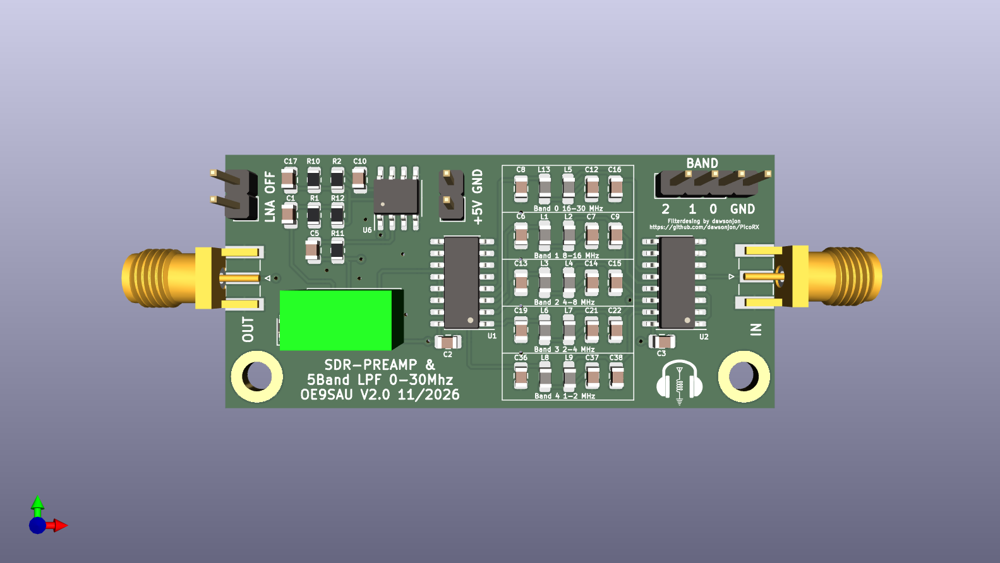
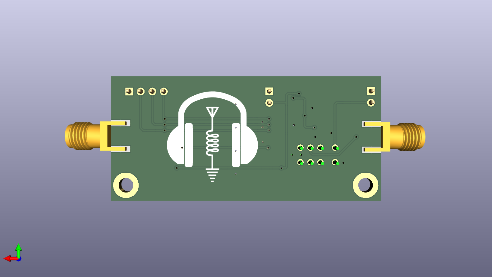

# Kompakter LNA mit integriertem 5-stufigem Tiefpassfilter 
**basierend auf dem LTC6226xS8, mit integriertem 5-fach-Tiefpassfilter für den Bereich 1–30 MHz.**
**Die Filterumschaltung erfolgt mit drei Steuerleitungen und zwei 74CBT3251-Multiplexer. Ausgangspegel ca. 10–12 dBm – für SDRs und andere Empfänger.**

*Compact LNA using an LTC6226xS8 amplifier with integrated 5-way low-pass filtering for the 1–30 MHz range.*
*Filter selection is handled via 3-bit control (A0–A2) and two 74CBT3251 multiplexers. Output level approx. 10–12 dBm – for SDRs and similar receivers.*

LPF-FILTERAUSWAHL - U1 / U2 (74CBT3251)

BAND_2  BAND_1  BAND_0  EINGANG  FILTER
  S2      S1      S0
---------------------------------------
   0       0       0      I0     16-30 MHz
   0       0       1      I1      8-16 MHz
   0       1       0      I2      4-8 MHz
   0       1       1      I3      2-4 MHz
   1       0       0      I4      1-2 MHz
   1       0       1      I5      GND
   1       1       0      I6      GND
   1       1       1      I7      GND
---------------------------------------
0 = LOW, 1 = HIGH
OE = GND (dauerhaft aktiviert)
